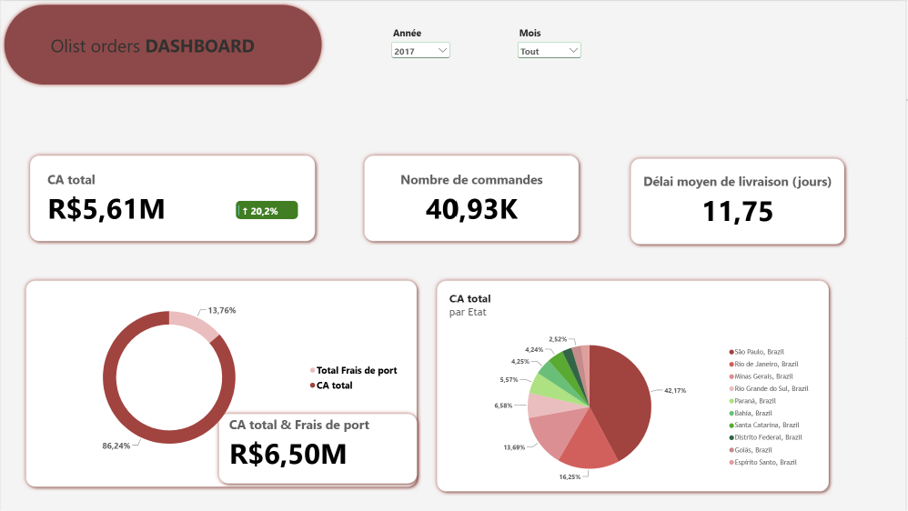
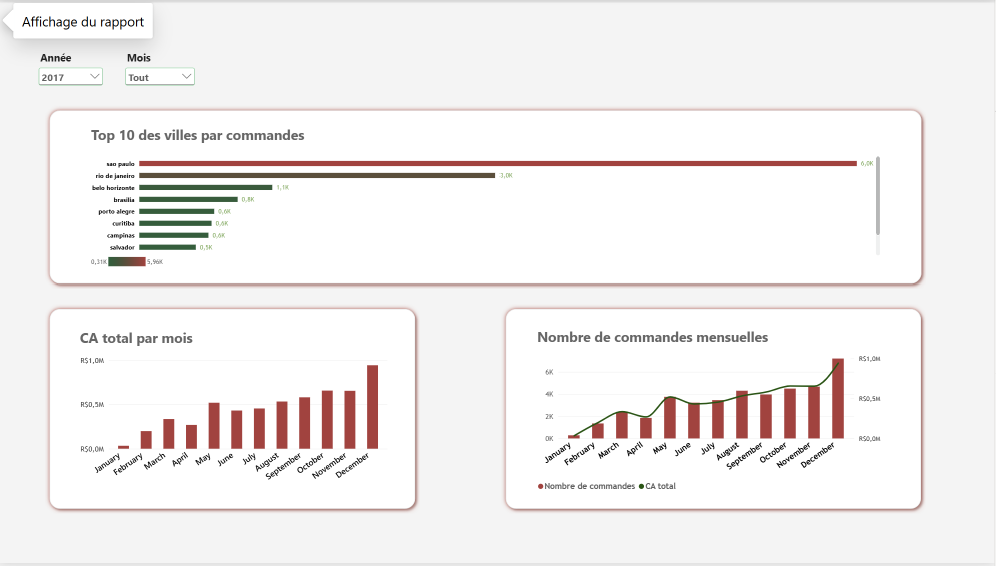
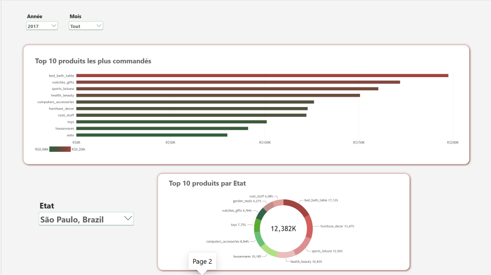

# Projet BI — Olist (E-commerce Brésil)

Projet CAP-PREP : pipeline BI complet sur le jeu de données public **Olist** (e-commerce brésilien, Kaggle).

```
CSV bruts (Kaggle) → Pentaho Data Integration (ETL) → SQL Server (entrepôt olist_dw) → Power BI (reporting)
```

Le déroulé détaillé, étape par étape, est suivi dans [`Plan-Projet.md`](Plan-Projet.md). Ce document résume le résultat : le modèle de données, les choix faits, les difficultés rencontrées et le dashboard obtenu.

---

## 1. Objectif métier

Répondre à partir des données réelles Olist à des questions comme :
- Quel est le chiffre d'affaires total et son évolution mensuelle ?
- Quelles sont les villes / catégories de produits qui génèrent le plus de commandes ?
- Quel est le délai moyen de livraison ?
- Quels états (régions brésiliennes) contribuent le plus au CA ?

---

## 2. Modèle de données (schéma en étoile)

Créé par [`migrations/01_create_database.sql`](migrations/01_create_database.sql) et [`migrations/02_create_tables.sql`](migrations/02_create_tables.sql).

**Table de faits** — `fact_order_items` (grain : une ligne = un article d'une commande)
- Mesures : `total_price`, `total_freight_value`, `total_order_items`, `delays` (écart livraison réelle / estimée)
- Clés étrangères : `product_key`, `customer_key`, `seller_key`, et 3 clés vers `dim_date` (date d'achat, de livraison, estimée)

**Dimensions**
| Table | Contenu |
|---|---|
| `dim_customers` | `customer_id`, `customer_city`, `customer_state` |
| `dim_seller` | `seller_id`, `seller_state` |
| `dim_products` | `product_id`, `product_weight_g` |
| `dim_date` | date complète + année / trimestre / mois / jour de semaine (générée, pas fournie par Olist) |


---

## 3. ETL (Pentaho Data Integration)

Le job [`ETL/ETL_pipeline.kjb`](ETL/ETL_pipeline.kjb) enchaîne les transformations dans l'ordre (dimensions avant faits, pour respecter les clés étrangères) :

```
dim_customer → dim_product → dim_date → dim_seller → fact_order_items
```

Traitements qualité appliqués pendant l'ETL (voir le détail des anomalies repérées à l'exploration dans [`dataset/NOTES.md`](dataset/NOTES.md)) :
- **Catégories produit** : traduction portugais → anglais par jointure avec `product_category_name_translation.csv` (attention gérée au BOM UTF-8 en tête de ce fichier) ; valeur `"unknown"` si la catégorie manque.
- **Encodage** : colonnes texte en `NVARCHAR` côté SQL Server pour les caractères accentués du portugais brésilien.

---

## 4. Dashboard Power BI

Fichier : [`olist_DW_VISUALISATION.pbix`](olist_DW_VISUALISATION.pbix) — connecté en **Import** sur `olist_dw`. Filtres communs : **Année** et **Mois**.

### Vue générale


KPI globaux (CA total, nombre de commandes, délai moyen de livraison), répartition CA vs frais de port, et CA total par état.

### Page 1 — Ventes & répartition géographique


Top 10 des villes par nombre de commandes, évolution du CA et du nombre de commandes par mois.

### Page 2 — Produits


Top 10 des catégories de produits les plus commandées, répartition du top 10 par état (filtre sur l'état, ex. São Paulo).

---

## 5. Difficultés rencontrées & choix faits

- **`customer_id` ≠ `customer_unique_id`** : un même client physique peut avoir plusieurs `customer_id` (un par commande). Le DW garde `customer_id` comme clé technique de la dimension, en connaissance de cause — pas une vraie dimension client dédupliquée.
- **Nulls sur les dates de livraison** dans `orders` : normaux pour les commandes non livrées/annulées, non "corrigés" artificiellement — d'où `date_order_del_cust_id` nullable dans `fact_order_items`.
- **Dérive script SQL / base réelle** (voir section 2) : les migrations n'ont pas toujours été tenues à jour après des modifications faites directement dans SSMS.

---

## 6. Reproduire le projet

1. SQL Server : exécuter [`migrations/01_create_database.sql`](migrations/01_create_database.sql) puis [`migrations/02_create_tables.sql`](migrations/02_create_tables.sql) dans SSMS.
2. Placer les CSV Olist (Kaggle) dans `dataset/` (dossier ignoré par git, voir `.gitignore`).
3. Pentaho : ouvrir [`ETL/ETL_pipeline.kjb`](ETL/ETL_pipeline.kjb) dans Spoon et l'exécuter (driver JDBC SQL Server requis dans le dossier `lib` de PDI).
4. Power BI : ouvrir [`olist_DW_VISUALISATION.pbix`](olist_DW_VISUALISATION.pbix), actualiser la connexion vers `olist_dw` si besoin.

---

## 7. Structure du repo

```
ETL/          transformations et job Pentaho (.ktr / .kjb)
migrations/   scripts SQL de création de l'entrepôt olist_dw
dataset/      CSV sources Olist (non versionnés) + notes d'exploration
images/       captures d'écran du dashboard Power BI
Plan-Projet.md   carnet de bord détaillé, étape par étape
olist_DW_VISUALISATION.pbix   le rapport Power BI
```
